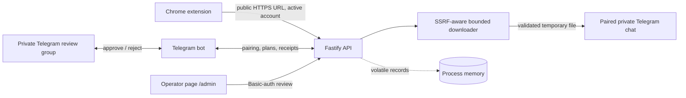

<div align="center">


# ARBRIDGE

**Your digital workspace, connected everywhere.**

*A public-link capture prototype by ARIAMIR — from Chrome to a Telegram chat you control.*

[](https://github.com/irariamir/ARBRIDGE/actions/workflows/ci.yml)


[Get started](#quick-start) · [What works](#current-capabilities) · [Architecture](#how-it-fits-together) · [Security](#security-and-privacy) · [Packages](#packages-and-workspaces) · [Releases](#releases-and-downloads)

</div>

---

ARBRIDGE explores a careful way to send a **public document link** from a Chrome extension to a paired Telegram account. The server fetches the file and can deliver it to the user's private Telegram chat after pairing and manual subscription approval.

> **Prototype, not a hosted service.** Pairings, sessions, receipts, subscriptions, and capture jobs exist in process memory and are lost when the API restarts. Example prices are not an offer. The Chrome and Telegram flows have not received live end-to-end testing. Do not use this prototype with sensitive material or expose it to the public internet.

## Current capabilities

- **Chrome MV3 extension:** side panel, pairing and transfer-status interface, and a context-menu action for public links.
- **Two-step Telegram pairing:** short-lived, single-use codes establish a temporary browser session with the Telegram account.
- **Bounded server-side downloads:** HTTPS-only public URL fetching, redirect-by-redirect DNS/IP checks, pinned addresses, size/time/redirect limits, file-signature checks, and temporary-file cleanup.
- **Telegram bot:** pairing, `/subscribe`, `/status`, `/library`, help and account commands; receipt intake and private reviewer-group approve/reject controls when configured.
- **Operator review page:** `/admin` with Basic authentication and the same manual receipt-review decisions.
- **Subscription gate:** sample plans are shown as **$4.99/month** and **$49.99/year**. These are illustrative values; payment collection is disabled until the operator configures the private review workflow.

### Not implemented / not production-ready

There is no connected database, persistent document library, payment processor, automatic payment verification, AI extraction/search, production deployment, or durable audit log. Manual receipt approval is not proof of payment: a reviewer must independently verify funds. The downloader does not use browser cookies, bypass login, or upload files from the local Downloads folder.

## How it fits together



## Quick start

### Requirements

- Node.js **22.13+** and npm **10+**.
- Chrome for loading the unpacked extension.
- A Telegram bot and private review group only if testing the bot-integrated flow. Use a fresh token stored in `.env`; never reuse a token exposed in chat or commit credentials.

### Install and verify

```sh
npm ci
npm run lint
npm run typecheck
npm test
npm run build
```

### Run locally

1. Copy `.env.example` to `.env`. Keep it private and configure only credentials you control. The API can start without a bot token; the Telegram-integrated flow cannot.
2. In one terminal, run `npm run dev:api` (default API: `http://127.0.0.1:8787`).
3. If using Telegram, configure the same secure internal secret in the API and bot, plus the bot username/token, private review group ID, and authorized **numeric** reviewer IDs. Start the bot in a second terminal with `npm run dev:bot`.
4. To preview the website, run `npm run dev:web` in another terminal.
5. Configure `ADMIN_USERNAME` and a unique `ADMIN_PASSWORD` of at least 24 characters before using `/admin`. Keep the API private; any deployed admin interface requires HTTPS.

See [the operator guide](docs/user-guides/subscriptions-admin.md) for the configuration and receipt-review details. No live Telegram message or payment request is sent by the tests.

### Build and load the Chrome extension

```sh
npm run build --workspace @arbridge/extension
```

In Chrome, open `chrome://extensions`, enable Developer mode, choose **Load unpacked**, and select `apps/extension/.output/chrome-mv3`. The development build targets the local API address. If CORS blocks the extension, set `EXTENSION_ORIGIN` to that exact unpacked extension origin and restart the API. Chrome-protected pages such as `chrome://downloads` cannot provide context-menu entries.

### Pair and transfer

1. Open the extension side panel and choose **Connect Telegram**.
2. Open the configured bot in Telegram and send the short-lived `/connect <code>` shown by the extension.
3. Enter the bot's second confirmation code in the extension within five minutes.
4. In the bot, use `/subscribe` to view sample plans. If an operator has enabled manual receipt review, submit a supported receipt and wait for an authorized reviewer to verify the payment and decide.
5. With an active subscription, submit a public HTTPS document link. The API downloads and validates the file, then sends it to the paired private Telegram chat.

## Packages and workspaces

These are **monorepo workspaces**, not published npm or GitHub Packages. Their `0.1.0` manifest versions are development package versions, not release promises.

| Workspace | Responsibility | Published? |
|---|---|---|
| `apps/extension` (`@arbridge/extension`) | WXT + React Chrome Manifest V3 extension | No |
| `apps/api` (`@arbridge/api`) | Fastify API, pairing, temporary sessions/jobs, subscription and review endpoints | No |
| `apps/telegram-bot` (`@arbridge/telegram-bot`) | grammY bot and reviewer controls | No |
| `apps/website` (`@arbridge/website`) | Static product and documentation website | No |
| `packages/download-engine` (`@arbridge/download-engine`) | Bounded HTTPS downloader and public-address validation | No; internal workspace |
| `packages/shared` (`@arbridge/shared`) | Shared types and illustrative plan catalog | No; internal workspace |

## Releases and downloads

**There is no published GitHub Release, npm package, GitHub Package, or Chrome Web Store listing yet.** Follow [GitHub Releases](https://github.com/irariamir/ARBRIDGE/releases) for actual published versions; do not treat the internal `0.1.0` workspace versions as releases.

The repository contains `artifacts/arbridge-extension-unpacked.zip` as a **local development build**. Extract it and load the included `chrome-mv3` directory through Chrome's extension manager. It targets local development and is not signed, a Chrome Web Store package, or a production release. Build the extension from source instead if you need the current workspace contents.

## Security and privacy

The downloader restricts requests to HTTPS and checked public DNS addresses, validates every redirect target, pins requests to inspected addresses, and applies byte, time, and redirect limits plus file-signature checks. These controls are a prototype baseline, not a complete production security system.

- Do not submit private documents, secret-bearing URLs, or material you are not authorized to share.
- Do not use this service to bypass authentication; browser cookies are not forwarded.
- Pairings, bearer sessions, receipts, subscriptions, and jobs are volatile and are cleared on API restart.
- A receipt is reviewed manually; no payment processor or automated verification is connected.
- Keep bot tokens, internal secrets, and admin credentials out of source control, logs, and chat. Revoke any token that has been exposed.
- Do not expose the API or admin page publicly. Rate limiting, durable account isolation, malware scanning, production worker isolation, persistent storage, and an independent security review are still needed.

Read [SECURITY.md](SECURITY.md) and the [URL-fetching security notes](docs/security/URL_FETCHING.md) before changing network-facing code. Report vulnerabilities privately as described in [SECURITY.md](SECURITY.md).

## Verification status

The current development branch passes CI for lint, typecheck, unit tests, dependency audit, and workspace builds. The latest local suite has **19 passing tests**. This does **not** verify Chrome UI installation, a live Telegram bot, reviewer callbacks, or an end-to-end transfer. The external downloader smoke test was blocked by the sandbox TLS trust chain; certificate validation was not disabled. Details are in [the verification record](docs/TESTING.md).

## Contributing

Start with [CONTRIBUTING.md](CONTRIBUTING.md), [development status](docs/development/README.md), and the [architecture overview](docs/architecture/OVERVIEW.md). Please report only reproducible behavior and genuine usage or adoption evidence; do not fabricate metrics, testimonials, or integrations.

## Project and maintainers

**Product:** ARBRIDGE · **Company:** ARIAMIR · **Website:** [ariamir.ct.ws](https://ariamir.ct.ws) · **License:** [MIT](LICENSE)

OpenAI maintains a separate [Codex for Open Source program](https://developers.openai.com/community/codex-for-oss). Selection and any benefits are determined by OpenAI and are not guaranteed. See [the factual program notes](docs/OPENAI_CODEX_FOR_OSS.md); no application or endorsement is implied.
